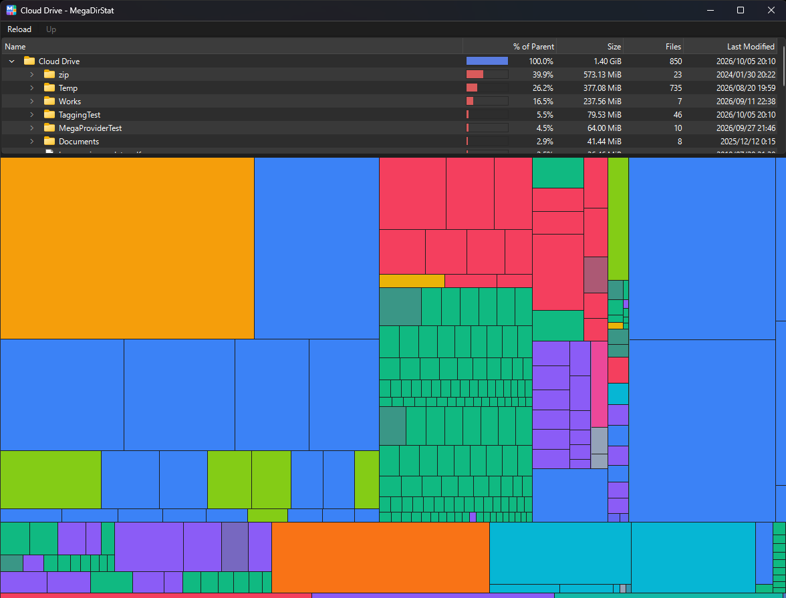

# MegaDirStat for MEGA Explorer



A MEGA Explorer plugin that shows what takes up the space in a folder: a size-sorted tree and a
treemap, in a window of its own. It reads only MEGA Explorer's in-memory copy of the account, so it
never contacts MEGA. Read-only.

## Usage

Right-click a folder → **MegaDirStat** → **Show folder sizes**. To see the whole drive, right-click
**Cloud Drive** in the side panel. Right-click an item in the window to focus on a folder or show
it in MEGA Explorer.

While the window is open the plugin counts as running, so its menu is greyed out; close the window
to run it on another folder.

## Installation

Unpack the release zip into a folder of its own in MEGA Explorer's plugins folder, so that
`plugin.json` sits directly in it (`...\plugins\dirstat\plugin.json`), and restart the app.
Everything it needs is in `bin\`.

## Building

Windows, Visual Studio 2022, Qt 6.8+ for MSVC, CMake 3.21+.

```
cmake --preset msvc
cmake --build --preset debug
ctest --preset debug
pwsh scripts\deploy.ps1     # Release build + Qt DLLs into bin\, which plugin.json starts
```

## License

MIT — see [LICENSE](LICENSE). The tree, treemap and size model come from MegaDirStat by the same
author.
