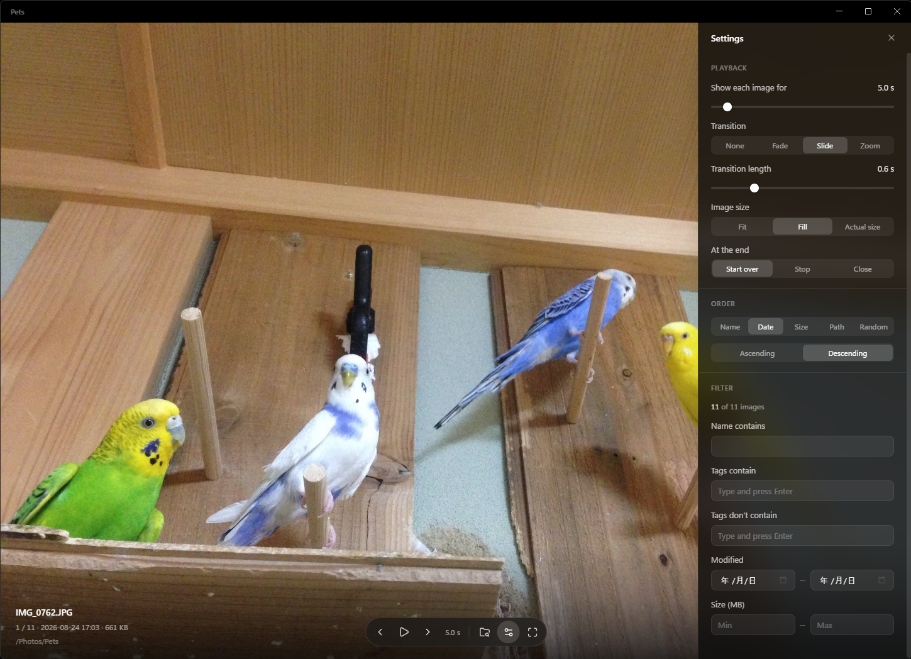

# Slideshow for MEGA Explorer



A MEGA Explorer plugin that plays the images in a folder as a slideshow, in a window of its own:
the order, the filter, how long each image stays and how one gives way to the next are all set
while it plays.

**Nothing is downloaded to disk.** Each image is read from MEGA as it is about to be shown,
through a local address MEGA Explorer serves it on, and decoded in memory. The list of images is
taken from MEGA Explorer's own copy of the account, so even a large folder opens at once.

## Features

Two commands in the **Slideshow** submenu of a folder's right-click menu (also on a folder view's
empty space and on the folder tree):

- **This folder only** — the images directly in the folder.
- **Including subfolders** — the images in the folder and everything below it.

The images are the files whose extension a browser engine can show: JPEG, PNG, WebP, GIF
(animated), AVIF and BMP. HEIC, TIFF, RAW and PSD files are left out. The list is read once, when
the command runs; files added or moved since stay out of it until it runs again.

**Playback** starts with the first image as soon as the window opens. The next two images are
loaded one after another in the background, so the change is immediate, and the time an image
stays counts from when it appears — a slow image never cuts the next one short.

| Control | Action |
| --- | --- |
| Space | Pause / play |
| ← / → , mouse wheel, clicking the left or right edge | Previous / next image |
| F, F11, double-clicking the image | Full screen; Esc leaves it |
| + / − | Show each image 0.5 s longer / shorter |
| S | Settings |

The controls and the file's name, date, size, folder and tags appear while the mouse moves and
fade out after a moment. **Show in MEGA Explorer** selects the current image in the app.

**Settings** (the panel on the right) apply at once, without restarting the slideshow:

- *Playback* — seconds per image (1–60), transition (none, fade, slide, zoom) and its length,
  image size (**Fit**: the whole image, as large as the window allows; **Fill**: the window
  covered, edges cut off; **Actual size**), and what happens after the last image (start over,
  stop, close the window).
- *Order* — by name (2 before 10), date modified, size or path, ascending or descending, or random,
  which shuffles again on every lap.
- *Filter* — name contains, formats, favourites only, tags, date modified range and size range, with the number of
  images that match. A tag term is typed and committed with Enter, then shown as a chip: an image
  is kept when its tags contain every term under **Tags contain** and none under **Tags don't
  contain** — part of a tag is enough, ignoring case.
- *Other* — whether the controls and the image info appear only while the mouse moves or stay on
  screen all the time (the cursor still hides when the mouse rests). **Countdown bar** (off by
  default): a thin bar along the bottom edge that shrinks until the next image, shown even while
  the controls are hidden. Never shown while paused or in full screen. **Image info**: the file's
  name, date, size, folder and tags shown with the controls.

The settings and the window's position and size are saved in `settings.json` in the plugin's
folder. Replacing the folder with a new version resets them.

## Requirements

- Windows 10 or 11, 64-bit.
- A MEGA Explorer whose plugin API has `items.streamUrl` (the `content.stream` permission). An older
  version rejects the plugin's manifest, so it does not appear in the menu.

## Installation

Unpack the zip into MEGA Explorer's plugins folder, so that `plugin.json` sits directly in a
folder of its own:

```
%LOCALAPPDATA%\MegaExplorer\MegaExplorer\plugins\slideshow\plugin.json
%LOCALAPPDATA%\MegaExplorer\MegaExplorer\plugins\slideshow\bin\win-unpacked\Slideshow.exe
...
```

Then restart MEGA Explorer. Everything the plugin needs is in `bin\`; nothing else has to be
installed.

## Building

Needs Node.js 22 or later.

```
npm ci
npm run typecheck
npm run pack       # builds bin/win-unpacked/, which plugin.json starts
npm run package    # the same, then the zip: ../dist/Slideshow-<version>.zip
```

The version is kept only in `plugin.json`; `npm run package` stamps it on the exe too. To try a
change in MEGA Explorer, link this folder into its plugins folder and run `npm run pack`: the next
click starts the new build. A change to `plugin.json` needs the app restarted.

| Path | What it holds |
| --- | --- |
| `src/main/` | The plugin process: the JSON-RPC connection to MEGA Explorer (`rpc.ts`), listing the images, the window and `settings.json` (`index.ts`). |
| `src/preload/` | The bridge the window's page calls the plugin process through. |
| `src/renderer/` | The window: playback and transitions (`App.tsx`, `Stage.tsx`), loading ahead (`loader.ts`), sorting and filtering (`playlist.ts`), the settings panel. |
| `src/shared/` | Types and defaults used on both sides. |
| `scripts/stdio_probe.mjs` | Starts the plugin with piped stdio, as MEGA Explorer does, and runs `initialize` → `command.execute` → `shutdown`. |
| `scripts/package.mjs` | `npm run package`. |

## License

MIT — see [LICENSE](LICENSE).
